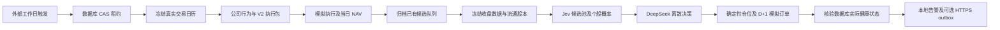

# C 组模拟前向运行手册

## 1. 目的和范围

映射 R14/R15/R46–R60。一次性程序协调 FKQT 的 Tushare 冻结数据与独立 JevInvestor：先执行当日到期模拟订单并保存 NAV（净资产值），再做当日收盘决策。Jev 预测类别概率，DeepSeek 只给离散动作，仓位与模拟成交由确定性代码负责。

不连接券商，不实时开盘下单，不内置常驻进程。当前抓取历史资料只验证链路，不具备历史 Point-in-Time（当时可用）证据，不是严格回测，不证明收益。



## 2. 前置条件

两个工作树和解释器必须存在：

| 用途 | 当前绝对路径 |
|---|---|
| JevInvestor | `C:/Users/1/Desktop/FKQTPRO/fkqt-jevInvestor-phase5-daily-runner` |
| JevInvestor Python | `C:/Users/1/Desktop/FKQTPRO/fkqt-jevInvestor/.venv/Scripts/python.exe` |
| FKQT agent | `C:/Users/1/Desktop/FKQTPRO/ai-signal-phase0/agent` |
| FKQT Python | `C:/Users/1/Desktop/FKQT-pro/agent/.venv-codex/Scripts/python.exe` |

JevInvestor 需要项目依赖；FKQT 需要原有 Tushare、pandas、pyarrow。新环境安装命令如下，已配置的本机无需重复安装：

```powershell
Set-Location 'C:/Users/1/Desktop/FKQTPRO/fkqt-jevInvestor-phase5-daily-runner'
& 'C:/Users/1/Desktop/FKQTPRO/fkqt-jevInvestor/.venv/Scripts/python.exe' -m pip install -e '.[dev]'
```

凭据只放本地 `.env` 或进程环境：`TUSHARE_TOKEN`、`TYPESAFE_API_KEY`、`DEEPSEEK_API_KEY`。配置加载只读取当前项目及 Git worktree 对应主仓库的既有 `.env`，不把值写入配置文件、报告或命令参数。

Tushare 需要 daily、trade_cal、stock_basic、namechange、suspend_d、stk_limit、dividend；决策换手率还需 daily_basic 的同日 float_share。该字段单位为万股，转换为百股匹配原日线 vol。无权限不补零、不静默删除换手率。[Tushare 官方 daily_basic 文档](https://tushare.pro/document/2?doc_id=32)。

示例模型为 `jev-latest` 与 `deepseek-flash`，DeepSeek 推理强度 high；旧 deepseek-chat/reasoner 被配置校验拒绝。Flash 的版本对应以官方发布说明为准：[DeepSeek 官方 V4.1 Flash](https://api-docs.deepseek.com/news/news260910/)。

## 3. 配置、迁移和独立账户

完整配置：`C:/Users/1/Desktop/FKQTPRO/fkqt-jevInvestor-phase5-daily-runner/config/forward.example.json`。

候选示例：同目录 `forward-candidates.example.txt`，仅两证券链路验证，不是选股推荐。正式运行须换成已确认 FKQT 队列的原始有序文件，显式容量，不能由模型选证券。

示例起始日 2026-09-28。迁移前备份实际数据库，不迁移沙耶回测数据；新独立 SQLite 数据库可运行：

```powershell
Set-Location 'C:/Users/1/Desktop/FKQTPRO/fkqt-jevInvestor-phase5-daily-runner'
$env:PYTHONPATH = 'C:/Users/1/Desktop/FKQTPRO/fkqt-jevInvestor-phase5-daily-runner/src'
$env:JEV_INVESTOR_DATABASE_URL = 'sqlite+aiosqlite:///C:/Users/1/Desktop/FKQTPRO/fkqt-jevInvestor-phase5-daily-runner/data/forward.db'
& 'C:/Users/1/Desktop/FKQTPRO/fkqt-jevInvestor/.venv/Scripts/python.exe' -m alembic upgrade head
& 'C:/Users/1/Desktop/FKQTPRO/fkqt-jevInvestor/.venv/Scripts/python.exe' -m fkqt_jevinvestor forward init --config 'C:/Users/1/Desktop/FKQTPRO/fkqt-jevInvestor-phase5-daily-runner/config/forward.example.json' --initial-cash 1000000
```

预期：迁移至 0009；init 输出组合编号、version=1、GROSS_V1。init 不是 reset，不覆盖已有同编号账户。系统不会在 run 内自动迁移或创建组合。

定时任务使用同一 DATABASE_URL；交互会话临时设置的变量不会自动传给任务，正式启用前须将上述非秘密数据库配置放入当前 JevInvestor 本地 `.env`。

## 4. 手工运行与状态

```powershell
Set-Location 'C:/Users/1/Desktop/FKQTPRO/fkqt-jevInvestor-phase5-daily-runner'
$env:PYTHONPATH = 'C:/Users/1/Desktop/FKQTPRO/fkqt-jevInvestor-phase5-daily-runner/src'
& 'C:/Users/1/Desktop/FKQTPRO/fkqt-jevInvestor/.venv/Scripts/python.exe' -m fkqt_jevinvestor forward run --config 'C:/Users/1/Desktop/FKQTPRO/fkqt-jevInvestor-phase5-daily-runner/config/forward.example.json' --date 2026-09-28
& 'C:/Users/1/Desktop/FKQTPRO/fkqt-jevInvestor/.venv/Scripts/python.exe' -m fkqt_jevinvestor forward status --config 'C:/Users/1/Desktop/FKQTPRO/fkqt-jevInvestor-phase5-daily-runner/config/forward.example.json' --date 2026-09-28
```

run 依次执行 CALENDAR、EXECUTION_PUBLISH、EXECUTION_PREPARE、EXECUTE、CANDIDATE_PREPARE、DECISION_PUBLISH、DECIDE、VERIFY。status 按组合、日期、当前配置哈希读取持久阶段，输出 attempts、error_code、next_retry_at。

| 状态 | 退出码 | 含义 |
|---|---|---|
| SUCCESS | 0 | 执行与决策已提交且健康检查通过，不代表策略盈利 |
| CLOSED | 0 | 冻结日历确认休市，无新增业务订单或 NAV |
| RETRY_PENDING | 3 | 尚未到重试时刻，不在进程内睡眠 |
| BUSY | 3 | 同组合租约被另一运行占用 |
| FAILED | 2 | 永久错误或重试耗尽，需人工定位 |
| DEGRADED | 2 | Provider 或必要数据不足；业务无信号记录仍保留 |

## 5. 恢复和停止条件

瞬时错误仅 DATA_NOT_READY、HTTP_429、NETWORK_TEMPORARY_FAILURE、FORWARD_PROCESS_TIMEOUT 自动重试：首次加 3 次重试，间隔 60/300/900 秒，默认最晚 23:00 中国标准时间；每个进程最大 300 秒，一次 run 总预算 600 秒。

租约以数据库 CAS（比较并更新）控制。进程死亡后租约到期可接管，已成功阶段沿用冻结结果；EXECUTE 根据真实 NAV 和执行哈希恢复，不重复成交。历史冻结交易日缺 NAV 时停止，不能直接跳到今天。

FAILED 不自动重置。先查询阶段及稳定错误码，修外部配置或权限；不能删除权益、订单、NAV 或改历史快照来强行变绿。冻结资料确实有误时应建立明确的新实验/账户保留旧审计，不能对正式历史同日期覆盖。当前没有自动回填永久失败日期的入口。

停止条件完整列表：凭据/权限不足、Schema 错误、哈希变化、证券或日期覆盖不全、历史 NAV 缺口、必要特征不足、权益历史缺失、配股/换股/未知公司行为、红股零碎股、资金或持仓不一致、租约丢失。

## 6. 公司行为 GROSS_V1

登记日收盘按 FIFO 原始 Lot 冻结权益；EX 确认税前现金应收和锁定红股；PAY 将应收转现金；LIST 解锁。周末生效日期保留为 effective_date，在下一处理交易日入账，处理日期另存。登记日后买入不追补权益，卖光后未付权益不丢失。

总资产 = 现金 + 持仓市值 + 分红应收；买入可用现金不包含应收。分红收入与卖出实现收益分列。送转重新分摊总成本，不把红股当免费收益；EX 相关旧订单失效，不跨日追单。

纯现金路径要求持仓、到期订单、应收和未结清权益全部为空。公司行为任一失败整日事务回滚。含新增权益的组合拒绝有损导出到旧回测契约，不要求沙耶立即改接口。

不模拟个人差别化红利税，不能称个人税后收益。不支持配股、证券换股、现金替代零碎股处置。

## 7. 告警与 Windows 外部触发

默认 webhook_url=null，告警只写 `data_root/<portfolio_id>/alerts.jsonl` 和数据库 outbox。只有显式设置 HTTPS Webhook 才发送；授权值只用 `FORWARD_WEBHOOK_AUTH_TOKEN` 本地环境。告警不含持仓明细、原始模型响应或 Key。

HTTP 失败留 PENDING 后续派送；事件 ID 稳定，接收方必须按 event_id 去重。只保证至少一次，不承诺分布式 exactly-once。恢复事件有独立 ID。

脚本仅生成，执行以下注册命令才启用任务；本次开发没有注册：

```powershell
& 'C:/Users/1/Desktop/FKQTPRO/fkqt-jevInvestor-phase5-daily-runner/scripts/install-forward-task.ps1' -Config 'C:/Users/1/Desktop/FKQTPRO/fkqt-jevInvestor-phase5-daily-runner/config/forward.example.json' -WhatIf
& 'C:/Users/1/Desktop/FKQTPRO/fkqt-jevInvestor-phase5-daily-runner/scripts/install-forward-task.ps1' -Config 'C:/Users/1/Desktop/FKQTPRO/fkqt-jevInvestor-phase5-daily-runner/config/forward.example.json'
Get-ScheduledTask -TaskName 'Fkqt-JevInvestor-Forward'
Start-ScheduledTask -TaskName 'Fkqt-JevInvestor-Forward'
& 'C:/Users/1/Desktop/FKQTPRO/fkqt-jevInvestor-phase5-daily-runner/scripts/uninstall-forward-task.ps1' -TaskName 'Fkqt-JevInvestor-Forward' -WhatIf
& 'C:/Users/1/Desktop/FKQTPRO/fkqt-jevInvestor-phase5-daily-runner/scripts/uninstall-forward-task.ps1' -TaskName 'Fkqt-JevInvestor-Forward'
```

触发为工作日 21:15 起每 5 分钟、持续 105 分钟；程序再查真实节假日日历。隐藏窗口、固定 cwd、IgnoreNew、12 分钟任务限制、不无限重启。使用当前用户 Interactive/Limited：用户注销时不运行；睡眠/关机时不保证补触发。不能把脚本生成当成已启用持续运行。

卸载只删指定任务，不删除数据库、冻结资料和账户。

## 8. 三种验证模式

```powershell
Set-Location 'C:/Users/1/Desktop/FKQTPRO/fkqt-jevInvestor-phase5-daily-runner'
$env:PYTHONPATH = 'C:/Users/1/Desktop/FKQTPRO/fkqt-jevInvestor-phase5-daily-runner/src'
& 'C:/Users/1/Desktop/FKQTPRO/fkqt-jevInvestor/.venv/Scripts/python.exe' -m fkqt_jevinvestor forward validate --config 'C:/Users/1/Desktop/FKQTPRO/fkqt-jevInvestor-phase5-daily-runner/config/forward.example.json' --mode PROVIDER_CONTRACT --date 2026-09-25 --live
& 'C:/Users/1/Desktop/FKQTPRO/fkqt-jevInvestor/.venv/Scripts/python.exe' -m fkqt_jevinvestor forward validate --config 'C:/Users/1/Desktop/FKQTPRO/fkqt-jevInvestor-phase5-daily-runner/config/forward.example.json' --mode REAL_SOURCE_REPLAY --date 2026-09-25 --live
& 'C:/Users/1/Desktop/FKQTPRO/fkqt-jevInvestor/.venv/Scripts/python.exe' -m fkqt_jevinvestor forward validate --config 'C:/Users/1/Desktop/FKQTPRO/fkqt-jevInvestor-phase5-daily-runner/config/forward.example.json' --mode LIVE_FORWARD --date 2026-09-28 --live
```

`--live` 会产生 API 调用费用；省略时 BLOCKED/LIVE_OPT_IN_REQUIRED，不联网。

PROVIDER_CONTRACT 验证七项接口与双模型合成输入契约；合法空响应只证明请求可访问，不证明行情已就绪。REAL_SOURCE_REPLAY 用小队列真实共同可用日、独立数据库和账户，不覆盖正式组合。LIVE_FORWARD 对未来日仅返回 LIVE_FORWARD_PENDING；真正跨两个已观察交易日的成交验证必须等后续调度实际发生，不能用历史行情替代。

报告在 `C:/Users/1/Desktop/FKQTPRO/fkqt-jevInvestor-phase5-daily-runner/data/validation/<run_id>/report.json`，Git 忽略。历史来源 strict_point_in_time=False/is_forward=False。

## 9. 自检与故障排查

| 检查项 | 标准值 | 检查方法 | 优先级 |
|---|---|---|---|
| 数据库迁移 | 0009 | alembic current | 必须 |
| 账户初始化 | 唯一编号、初始现金明确 | init JSON 与数据库 | 必须 |
| 候选队列 | 有序、唯一、数量不超显式容量 | 冻结 Queue 与 source hash | 必须 |
| 健康状态 | 必要数据/Provider 缺失不能 SUCCESS | VERIFY 与决策持久记录 | 必须 |
| NAV 顺序 | 每个真实前序交易日齐全 | status/数据库 NAV | 必须 |
| 权益资产 | 应收计 NAV、不计买入现金 | 公司行为账本测试 | 必须 |
| Secret | 配置/报告无值 | 暂存 diff 脱敏扫描 | 必须 |
| 外部写边界 | 无券商、任务未自动安装 | 脚本与执行记录 | 必须 |

`FORWARD_DATA_DEGRADED`：查逐股 missing_reason，不填零；`FLOAT_SHARES_UNAVAILABLE`：确认 daily_basic 权限及同日资料；`DAILY_EXECUTION_HISTORY_GAP`：先处理最早缺口，勿改日历；`EXECUTION_INPUT_CONFLICT`：保留旧 NAV，不换包强覆盖；`CORPORATE_ACTION_HISTORY_MISSING`：补齐真实历史权益证据或新实验起点，勿虚构；`FORWARD_COMMAND_FAILED`：检查配置绝对路径、依赖和数据库迁移，原异常不输出以免泄密。

## 10. 文件清单

路径均相对上文 JevInvestor 根：配置 `config/forward.example.json`、队列 `config/forward-candidates.example.txt`；程序 `src/fkqt_jevinvestor/operations/`；迁移 `migrations/versions/0008_forward_corporate_actions.py`、`0009_forward_operations.py`；调度脚本 `scripts/forward-task.ps1`、`install-forward-task.ps1`、`uninstall-forward-task.ps1`；验收事实 `docs/validation/2026-09-26-forward-operations.md`。
