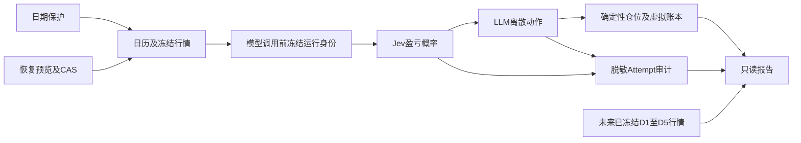

# 前向安全、诊断、恢复与评估操作手册

## 1. 交付范围

对应 R61–R64。普通运行拒绝未来日期和北京时间当日15:00前；新增诊断和实际用量审计；人工恢复必须预览、CAS提交并保留历史；评估只读冻结结果。Jev给出有限标签概率，LLM选择离散动作，仓位和成交仍由确定性代码负责。



恢复不得重置 DECIDE/VERIFY，未来标签不得回送模型。没有券商、常驻进程、自动任务注册、模型回退或因子配比。

## 2. 前置条件

工作树：`C:/Users/1/Desktop/FKQTPRO/fkqt-jevInvestor-phase5-daily-runner`。Python：`C:/Users/1/Desktop/FKQTPRO/fkqt-jevInvestor/.venv/Scripts/python.exe`。数据库必须已升级到 `0010_forward_safety_evaluation`。诊断、恢复预览和报告不需要真实模型调用；正式run仍需要原有凭据及FKQT冻结数据。

已有环境无需重装。仅新环境使用项目锁定依赖的安装流程，不在本阶段升级SDK。配置文件不含API Key，密钥只放本地环境；公开仓库不得提交 `.env`、数据库、诊断数据。

```powershell
Set-Location 'C:/Users/1/Desktop/FKQTPRO/fkqt-jevInvestor-phase5-daily-runner'
$env:PYTHONPATH='C:/Users/1/Desktop/FKQTPRO/fkqt-jevInvestor-phase5-daily-runner/src'
$taskPython='C:/Users/1/Desktop/FKQTPRO/fkqt-jevInvestor/.venv/Scripts/python.exe'
$taskConfig='C:/Users/1/Desktop/FKQTPRO/fkqt-jevInvestor-phase5-daily-runner/data/forward-live-20260928/config.json'
$env:JEV_INVESTOR_DATABASE_URL='sqlite+aiosqlite:///C:/Users/1/Desktop/FKQTPRO/fkqt-jevInvestor-phase5-daily-runner/data/forward-live-20260928/forward.db'
```

### 2.1 数据库迁移（需要操作员手动执行）

本轮未升级既有前向账户，只升级验收副本。第一次正式使用新功能前，停止调度，确认数据库无写入，保存备份，再执行迁移。不要把开发默认数据库误当生产账户。

```powershell
$taskDatabase='C:/Users/1/Desktop/FKQTPRO/fkqt-jevInvestor-phase5-daily-runner/data/forward-live-20260928/forward.db'
$taskBackup='C:/Users/1/Desktop/FKQTPRO/fkqt-jevInvestor-phase5-daily-runner/data/forward-live-20260928/forward-before-0010.db'
if (Test-Path -LiteralPath $taskBackup) { throw 'BACKUP_ALREADY_EXISTS' }
Copy-Item -LiteralPath $taskDatabase -Destination $taskBackup
& $taskPython -c "from alembic.config import Config; from alembic import command; c=Config('alembic.ini'); c.set_main_option('sqlalchemy.url','sqlite+aiosqlite:///C:/Users/1/Desktop/FKQTPRO/fkqt-jevInvestor-phase5-daily-runner/data/forward-live-20260928/forward.db'); command.upgrade(c,'head')"
if ($LASTEXITCODE -ne 0) { throw 'MIGRATION_FAILED' }
```

预期新增两类Attempt的可空审计字段及恢复审计表，旧模型输入、V1哈希和回测Entity不变。有诊断、用量或恢复记录时降级拒绝 `FORWARD_SAFETY_DOWNGRADE_DATA_LOSS`，不得删审计绕过。SQLite正在写入时不能采用简单文件复制备份，应先停止写入。

## 3. 日期保护与退出码

```powershell
& $taskPython -m fkqt_jevinvestor forward run --config $taskConfig --date 2099-01-01
```

必定返回 `BLOCKED/FORWARD_FUTURE_DATE`，退出2，不产生目录、租约、业务写入或outbox发送。当天14:59:59返回 `FORWARD_BEFORE_MARKET_CLOSE`，15:00允许进入原就绪校验；15:00本身不代表行情已齐备。历史日期保留历史重放语义，不是未来运行绕过入口。

| 退出码 | 含义 | 操作 |
|---|---|---|
| 0 | SUCCESS、CLOSED或只读命令成功 | 保存输出 |
| 2 | 阻断、永久失败、退化或恢复拒绝 | 先查稳定错误码 |
| 3 | RETRY_PENDING或BUSY | 外部调度按原有限重试规则处理 |

CALENDAR成功记录运行当时日期：当天为 `LIVE_FORWARD`，历史为 `REAL_SOURCE_REPLAY`。旧记录没有该证据则 `UNVERIFIED`；报告不能替旧记录补造前向身份。

## 4. 只读诊断

```powershell
& $taskPython -m fkqt_jevinvestor forward diagnostics --config $taskConfig --date 2026-09-28
```

预期JSON包含关联运行、Attempt、状态、原响应哈希、脱敏诊断和合法usage。Jev只保存已知问题和标签、最多64字符有限数字、具体稳定校验原因、未知字段计数及身份哈希，最多16KiB。未知问题/标签的原字符串、完整异常、Secret、自由响应不进入新诊断。传输失败只保留异常类型白名单，不伪造响应。

SDK未提供合法usage时为null，不按文本长度推算token。DeepSeek输入/输出token同样只保存实际值。审计从Provider到Repository显式传递且不进入正式模型序列化；缓存读取保留审计，canonical内容不变。

新运行在Jev调用之前写入 `data_root/daily_audits/RUN_ID/run-identity.json`，绑定组合、日期、运行UUID、行情哈希、完整证券集合、配置哈希及内容哈希。这样Jev已调用但LLM尚未提交的崩溃也能被关联。旧运行身份缺失时明确标记 `RUN_IDENTITY_UNAVAILABLE`，不能认定调用数为零。

## 5. 受控恢复

### 5.1 默认预览，无写入

```powershell
$taskPreviewText = & $taskPython -m fkqt_jevinvestor forward recover --config $taskConfig --date 2026-09-28 --stage CALENDAR --reason '已修复网络配置并核对冻结输入'
$taskPreviewText
$taskPreview = $taskPreviewText | ConvertFrom-Json
```

预期 `allowed`、拒绝码、原阶段状态、业务提交证据及 `stage_hash`。没有FAILED阶段、前置未成功、后续已成功/运行、输入冲突或模型阶段均拒绝。EXECUTE已有NAV时必须与POST_EXECUTION和EXECUTION_PREPARE的执行哈希及资产一致；NAV或快照单边存在直接拒绝。

### 5.2 根因已修复才显式提交

```powershell
if (-not $taskPreview.allowed) { throw 'RECOVERY_PREVIEW_REFUSED' }
& $taskPython -m fkqt_jevinvestor forward recover --config $taskConfig --date 2026-09-28 --stage CALENDAR --reason '已修复网络配置并核对冻结输入' --commit --expected-stage-hash $taskPreview.stage_hash
```

CAS（比较后交换）提交重新获取独占租约、重读业务事实和阶段哈希。原FAILED状态、错误、次数、输入及业务证据进入不可变审计；阶段变为RETRY_PENDING，累计attempts不归零。下一次正常run消费恢复授权，不自动恢复第二次永久失败；原剩余自动重试额度不被扩充。

相同恢复身份和原因重复提交幂等；过期预览或租约被替换拒绝。原因长度1–256，禁止控制字符、常见Secret格式和URL。恢复不修根因、不解除冻结冲突、不删除NAV/成交/权益，不重新评估正式模型。

## 6. 只读评估报告

```powershell
& $taskPython -m fkqt_jevinvestor forward report --config $taskConfig --from-date 2026-09-28 --to-date 2026-09-28 --output-root 'C:/Users/1/Desktop/FKQTPRO/fkqt-jevInvestor-phase5-daily-runner/data/forward-live-20260928/reports'
```

预期一份内容寻址JSON和一份同源中文Markdown。JSON是完整机器交付，Markdown按章节呈现同一数据。`generated_at`不参与report_hash；重复生成复用原文件，内容冲突拒绝覆盖。

| 内容 | 分母/口径 | 缺失处理 |
|---|---|---|
| 决策完整性 | 冻结完整证券集合，含HELD_ONLY | 缺记录保留；无身份时UNKNOWN，不报100% |
| Provider质量 | UNIVERSE/SYMBOL/LLM正式结果与实际拥有的Attempt分列 | 本地DATA_UNAVAILABLE跳过单列；复用不新增调用 |
| 用量与费用 | 实际usage、精确历史价格身份 | 缺失null，已知部分费用和覆盖率单列 |
| 收益 | 区间前NAV或明确初始资金 | 日历或NAV缺口不给收益结论 |
| 回撤 | 含基准资金的区间滚动峰值 | 缺口不补0 |
| 分红/已实现收益 | 税前GROSS_V1分别列出 | 缺冻结账户快照为null |
| 未来标签 | D1至D5真实交易日链及D5完整窗口同一复权基准 | 未成熟PENDING；缺行情/歧义不可评分 |
| 概率评分 | 四个盈亏问题分组，未折半多类Brier，10个固定桶 | 无成熟可比样本时null |

模式、模型、Provider、问题、criteria、特征和仓位版本不混合评分。配置/模式/版本混合时总体NAV收益标记 `MIXED_CONFIGURATION` 并清空结论。AVOID/KEEP是合法AVAILABLE动作，不算失败。Universe和data_sufficiency不伪造个股盈亏标签。没有年化、Sharpe或有效性证明。

### 6.1 可选价格配置

价格文件必须由操作员提供已核对的历史计费配置，不自动查询今天单价回填过去账单。JSON顶层数组；每条只能使用token计费或按请求计费，不能同时收费。以下只是文件格式，不代表TypeSafe或DeepSeek真实价格。

```json
[
  {
    "provider": "offline-example",
    "model": "offline-example-model",
    "version": "offline-example-v1",
    "effective_from": "2026-09-01",
    "effective_to": "2026-09-30",
    "currency": "CNY",
    "input_per_million": "2",
    "output_per_million": "4"
  }
]
```

按请求的完整格式：

```json
[
  {
    "provider": "offline-example",
    "model": "offline-example-model",
    "version": "offline-example-v1",
    "effective_from": "2026-09-01",
    "effective_to": "2026-09-30",
    "currency": "CNY",
    "per_request": "0.01"
  }
]
```

将实际核对文件保存在 `C:/Users/1/Desktop/FKQTPRO/fkqt-jevInvestor-phase5-daily-runner/data/forward-live-20260928/pricing.json` 后：

```powershell
& $taskPython -m fkqt_jevinvestor forward report --config $taskConfig --from-date 2026-09-28 --to-date 2026-09-28 --output-root 'C:/Users/1/Desktop/FKQTPRO/fkqt-jevInvestor-phase5-daily-runner/data/forward-live-20260928/reports' --pricing-json 'C:/Users/1/Desktop/FKQTPRO/fkqt-jevInvestor-phase5-daily-runner/data/forward-live-20260928/pricing.json'
```

结果只称 `ESTIMATED`，不是实际账单。币种只接受CNY/USD，不换汇。仅NAV可用且全部调用费用完整为CNY时计算扣模型估算费用收益，否则null并列原因；模拟成交费和模型费不重复入账。

## 7. 自检与故障定位

| 检查项 | 标准值 | 检查方法 | 优先级 |
|---|---|---|---|
| 日期保护 | future/14:59:59退出2且无副作用 | date_guard与CLI副本哈希对比 | 必须 |
| 诊断安全 | ≤16384字节，无恶意自由字段 | provider_diagnostics测试及诊断查询 | 必须 |
| 缓存兼容 | canonical不包含审计，缓存审计一致 | Provider序列化与Repository测试 | 必须 |
| 人工恢复 | CAS/租约围栏；次数累计；业务冲突拒绝 | forward_recovery真实DB测试 | 必须 |
| 完整分母 | 两个冻结证券、零决策时分母仍2 | forward_evaluation测试 | 必须 |
| 标签成熟 | 完整5交易日，D5同口径 | future窗口/缺口测试 | 必须 |
| 数值公式 | 手算Brier=0.68，回撤=0.10，收益=-0.01 | forward_evaluation_metrics测试 | 必须 |
| 迁移安全 | head0010；29张业务表；非空拒降级 | migration_chain与safety_migration测试 | 必须 |
| 数据库只读 | 报告/预览/future后文件哈希不变 | 验收副本Get-FileHash | 必须 |

| 错误/状态 | 含义 | 处理 |
|---|---|---|
| FORWARD_FUTURE_DATE | 日期尚未来临 | 等实际交易日，不使用绕过 |
| FORWARD_BEFORE_MARKET_CLOSE | 北京时间未到15:00 | 等收盘且行情齐备 |
| FORWARD_RECOVERY_STALE_PREVIEW | 事实已改变 | 重新预览，禁止复用旧hash |
| FORWARD_LEASE_BUSY/LOST | 有其他运行或租约所有权已变 | 停止并核对外部调度 |
| FORWARD_RECOVERY_INPUT_CONFLICT | 冻结/业务证据冲突 | 查原执行包与NAV，不强行恢复 |
| FORWARD_RECOVERY_MODEL_REEVALUATION_FORBIDDEN | 想重评正式模型 | 只能建立独立实验 |
| REPORT_PRICING_INVALID/OVERLAP | 价格格式错误或重复生效 | 修价格文件，不填0 |
| REPORT_OUTPUT_CONFLICT | 内容寻址文件被改动 | 保留原文件，检查来源 |
| PENDING_LABELS | 未来窗口未成熟 | 等冻结行情，不凭自然日补齐 |
| UNVERIFIED | 旧运行无模式证明 | 保留未知，不改称真正前向 |

## 8. 文件清单与限制

完整绝对路径清单和实际验收记录见 `C:/Users/1/Desktop/FKQTPRO/fkqt-jevInvestor-phase5-daily-runner/docs/validation/2026-09-26-forward-safety-evaluation.md`。源码、迁移、测试随本地分支交付；数据库及报告副本在忽略的data目录，不进公开Git。

已知限制：旧失败响应和缺usage不可追回；缺新运行身份的旧Jev-only崩溃不能可靠归属于某组合；多份未来冻结来源有歧义时不评分；历史验收副本配置无法证明与原配置相同，收益结论被保守阻断。本轮不启用真实前向、不合并Contributor回测、不推送或建PR。
