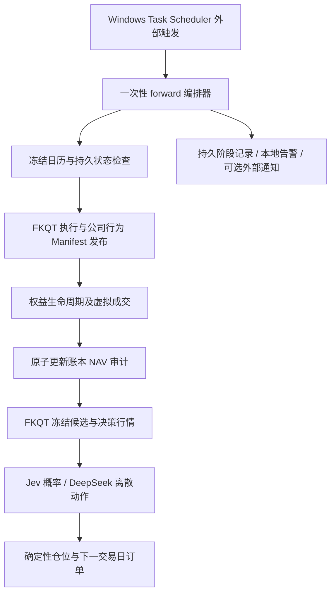

# C 组前向运行补齐设计：事项 2–6

日期：2026-09-26

状态：用户于 2026-09-26 确认设计；需求已纳入 R54–R60，实施计划等待审阅，不代表功能已实现。

## 1. 目标与边界

完成用户指定的现金空仓日、候选队列版本化、真实接口验证、外部调度与告警、分红送转账本支持，使 C 组能够持续进行可审计的 A 股日频模拟。

保持 Jev 概率 → LLM 离散动作 → 确定性仓位的责任边界。FKQT 是唯一 Tushare 采集方；JEV 仓库只读冻结文件。不接券商，不改沙耶回测引擎，不实现 A/B/D，不新增前端，不自动购买数据权限。

本设计采用现有服务的加法扩展，而不是替换执行引擎。备选的独立大型回测框架会改变账本和 Contributor 接口，故不采用；内置常驻调度器违反 R49，故不采用。

## 2. 前置条件与现状

- JEV 基线：`C:/Users/1/Desktop/FKQTPRO/fkqt-jevInvestor-phase5-daily-runner`，现有 Phase 5 CLI、ExecutionBundleV1、SQLite/SQLAlchemy 账本。
- FKQT 发布端：`C:/Users/1/Desktop/FKQTPRO/ai-signal-phase0/agent`，已有 forward_publisher 和执行 Manifest 发布链。
- Python 运行时优先复用 `C:/Users/1/Desktop/FKQTPRO/fkqt-jevInvestor/.venv/Scripts/python.exe`；FKQT 解释器在实施时单独核验，不假设存在。
- 已读需求 R1–R53；冻结需求没有包含本次完整公司行为和调度实现，必须新增编号，不覆盖已确认条款。
- 现有 ExecutionBundleV1 的 `verify` 用证券快照证明交易日开放，因此不能直接允许空字典。
- 现有 FIFO Lot 只保存取得日、数量和成本，没有公司行为权益、现金应收或红股上市限制。
- 真实权限、密钥可用性尚未验证。输出只记录凭据是否存在及接口错误码，不打印配置对象、Token 或响应中的敏感值。

## 3. 已确认新增需求

以下编号已写入 REQUIREMENTS.md；两份文档发生差异时以需求基线为准。

| 编号 | 做什么 | 不做什么与约束 |
|---|---|---|
| R54 | 现金空仓日生成零成交 NAV，交易日由冻结日历证明 | 不用伪造证券证明开市；不静默跳过日期 |
| R55 | 从 FKQT 冻结有序队列生成不可变候选版本，并自动提供给日运行 | 不新增选股策略；不让模型自由选代码；不固定容量为 80 |
| R56 | 分别验证 Tushare、TypeSafe、DeepSeek，执行小规模真实数据闭环 | 不将离线 Fixture、历史重放或 Provider 失败称为真实前向成功 |
| R57 | 外部调度调用一次性编排器，支持状态持久化、重试、锁和告警 | 不新增常驻服务；不自动注册系统任务或发送到未批准外部地址 |
| R58 | 支持现金分红与送转的权益、应收、支付、上市、成本和审计 | 不推算配股、合并换股或零碎股处置；信息不完整时停止 |
| R59 | 新 Schema 加法扩展，V1 历史哈希和沙耶契约保持兼容 | 不覆盖历史快照，不改 backtest-contract-v1 定义 |
| R60 | 税务口径显式采用 GROSS_V1 税前模拟并标记报告 | 不宣称为真实个人税后收益；不硬编码未知差别化税务 |

## 4. 数据流

每个有效交易日先完成当日执行及 NAV，再做当日收盘决策。执行仍在收盘行情齐备后回放开盘成交，不是实时开盘交易。现金空仓日与普通日使用相同顺序。

## 5. 子项目一：空仓日与候选版本

### 5.1 空仓日

新增 ExecutionBundleV2，包含独立的冻结交易日证明及其来源哈希；证券快照可为空。V1 读取和哈希算法不变。V2 同样绑定来源 Manifest、证券全集和公司行为集合。

只有数据库确认持仓、到期订单、未支付权益、未上市红股全部为空时，才走 CASH_ONLY 路径。零证券但存在现金应收款，不等于无权益的纯现金日。

该路径校验日历、组合版本和输入哈希，生成 fill_count=0、market_value=0 的 NAV，组合版本按现有提交规则推进。相同日期与哈希重放只返回旧结果；换包拒绝。非交易日不生成 NAV。初始空仓日须显式指定模拟起始日，禁止补写账户成立前净值。

### 5.2 候选队列

复用 FKQT 已冻结 candidate_universe 的 symbol/rank，不重新按收益、成交量选股。输入可以是外部选股流程导出的完整有序代码文件，但必须带来源标识、有效日期和容量。

CandidateQueueV1 保存 schema_version、trade_date、source_id、source_version、candidate_limit、ordered_symbols、created_at、content_hash。哈希清空自身字段后计算；顺序参与哈希。同日不同队列保留独立版本，正式运行需显式选定一个，不取“最新文件”。

FKQT 使用同一队列发布行情，JEV 从相同不可变版本读取候选，不再人工同步环境变量。环境变量旧入口继续可用。队列外持仓只扩展行情范围，不改变候选顺序或占用容量。

## 6. 子项目二：公司行为账本

### 6.1 上游事件

FKQT 发布 CorporateActionManifestV1，含 source event ID、证券、实施状态、首次可用时间、登记日、除权除息日、派息日、红股上市日、税前每股现金和每股送转比例。只接收已实施且日期/金额完整的事件，公告更新产生新版本，不覆盖旧数据。

事件查询覆盖权益存续证券，不限于当前候选或当前持仓。全部卖出后仍可能收到已登记现金分红。数据分页必须完整；无法证明完整性不得视为空事件集合。

### 6.2 生命周期与估值

1. 登记日虚拟成交完成后，按当日收盘 Lot 数量冻结权益，排除下一日买入的股票。日历或历史持仓不完整时拒绝推算权益。
2. 除息日将税前现金权益记为 dividend_receivable；尚未派息不能用于买入。金额在事件总权益层面 ROUND_HALF_UP 到 0.01 CNY。
3. 送转在除权日形成锁定红股权益，参与收盘资产估值；上市日前不可卖出。原总成本保持，单位成本在原股与新增股间分摊；FIFO 取得日继承原 Lot，另存 available_on 控制上市限制。
4. 派息日将应收现金转入可用现金，不重复增加收益；红股上市日只释放可卖限制，不再次增加股票数量或权益。
5. NAV 总资产 = 可用现金 + 股票市值（含已确认锁定红股）+ 现金应收。股票卖出收益与 dividend_income 分列；模型持仓输入和仓位分母使用包含应收的总资产，但可用资金只使用现金。
6. 同一 portfolio/event/stage 数据库唯一约束；公司行为与成交、NAV、审计同事务提交。支付或上市发生在非交易日时，下一次交易日编排处理已到期权益，保存真实生效日期，不生成非交易日 NAV。

零碎股权益不凭空向下取整或按价格折现：要求有可信的实际分配信息，否则返回 CORPORATE_ACTION_FRACTIONAL_UNSUPPORTED 并停止该日。配股、换股、退市现金处置仍返回明确未支持错误。

### 6.3 订单与兼容

除权日价格和股数变化会使旧计划数量过期。当天涉及公司行为的证券，原到期虚拟订单以 CORPORATE_ACTION_ORDER_EXPIRED 终结，不用旧数量成交，也不借机反转方向；当日收盘从更新后的组合重新决策。

新增持久字段默认零或空，新增 Lot 可卖日期默认保持原 T+1 逻辑。PortfolioState 和旧回测 Entity 不移除成员；旧 V1 输入不得隐式携带公司行为。含新权益的组合若请求旧版回测导出，明确拒绝，不能丢失资产后导出。

GROSS_V1 是明确的研究模拟口径：现金分红采用税前值，不模拟个人差别化红利税，不将此结果称为税后收益。不同税务版本不得在同一正式运行内混用。

## 7. 子项目三：真实接口与持续编排

### 7.1 验证入口

只读取本地已配置 Secret；检查存在性，不复制到仓库。Tushare 探针在 FKQT 执行，逐项记录 daily、trade_cal、stock_basic、namechange、suspend_d、stk_limit、dividend 的权限、返回完整性及耗时。JEV 侧分别运行 TypeSafe 与 DeepSeek 的真实契约探针，实际模型 ID 入审计，不自动换模型。

先选显式小队列（实施验收建议 2 个证券，不设产品默认容量）与独立模拟账户验证链路。历史 D/D+1 数据只能验收为真实来源重放；真正前向须等待尚未发生的下一交易日数据，不能在当天报告完整未来闭环。

任何缺少密钥、权限不足、数据未就绪或模型不可用均进入报告，不能合成概率补齐。部分探针失败时仍完成离线代码与其他权限验证，保留真实运行未完成状态。

### 7.2 一次性编排

新增配置化一次性编排器，用标准库 subprocess 参数数组分别调用 FKQT 与 JEV 的已存在 CLI；绝不 shell 拼接命令。参数指定两个仓库 cwd、解释器、组合、配置文件、数据根和交易日。

外部调度只负责周期触发。每次调用读取数据库阶段状态，确认日历和缺失日期，按先执行后决策顺序推进。阶段记录包含日期、配置哈希、候选哈希、输入哈希、开始/结束时间、退出码、重试次数和下一重试时刻。

数据库 CAS 租约避免同组合并发；进程崩溃后租约过期可恢复，但先核对实际 NAV、订单及冻结结果，不能凭本地标记重复提交。数据未就绪、限流及临时网络失败允许退避重试；凭据错误、Schema 错误、哈希冲突、缺失历史权益与不支持公司行为立即终止。

一次调用设置总时限，不循环等待数小时；数据未就绪返回 RETRY_PENDING，交给下一次外部触发。超时终止子进程并保存错误，日志限制大小且脱敏。

默认告警写入本地 JSONL 和非零退出码；可配置 HTTPS Webhook，用事件 ID 去重，发送失败存入 outbox。外部 URL 未配置时不能宣称已发送远程告警。失败后恢复只发一次恢复事件，不为重复不变状态反复通知。

提供 Windows Task Scheduler 安装/查看/卸载脚本及跨平台手工命令；脚本采用绝对路径、隐藏窗口和固定 cwd。生成脚本不等于安装系统任务，本次不自动启用常驻计划、不创建 Codex 自动任务。

## 8. 依赖顺序与预计规模

| 工作包 | 输入 | 交付 | 依赖 |
|---|---|---|---|
| F1 | 既有账本与日历 | V2 空仓执行、零成交 NAV、兼容测试 | 设计与实施计划批准 |
| F2 | FKQT 队列 Manifest | 候选版本导出/读取 CLI、哈希与来源验证 | F1 可独立开发 |
| F3 | 公司行为字段、登记日持仓 | 事件发布、权益账本、迁移、估值、订单失效规则 | F1，新字段兼容规范 |
| F4 | F1–F3 CLI | 外部一次性编排、重试、租约、告警与调度脚本 | F1–F3 |
| F5 | 本地配置与外部权限 | 脱敏权限报告、真实模型探针、两日闭环记录 | F1–F4，真实凭据 |
| F6 | 全部实现 | 阶段验收、运行手册、变更清单 | F1–F5；外部阻塞须分列 |

这是跨两个仓库的阶段工作，不承诺一次消息内完成。只做最小相关测试，修复后只重跑失败项；最终统一离线套件、静态检查、迁移往返和 Secret 扫描。预计代码实施与核验为数个工作包；真实前向日数受交易日历限制，不用历史回放替代。

## 9. 自检与预期输出

| 检查项 | 标准值 | 检查方法 | 优先级 |
|---|---|---|---|
| 纯现金日 | 0 成交、0 市值、NAV 连续 | 连续交易日集成测试与数据库查询 | 必须 |
| 非交易日 | 0 新 NAV | 日历关闭 Fixture | 必须 |
| 空包合法性 | 有独立日历证明；有权益时禁止纯现金捷径 | 篡改、缺证明、未支付权益测试 | 必须 |
| 候选版本 | 顺序影响哈希，历史不可覆盖 | 顺序交换、重复、超容量测试 | 必须 |
| 现金分红 | 登记数量固定，应收转现金不重复盈利 | 登记后卖出、除息后买入、不同支付日测试 | 必须 |
| 红股 | 总成本守恒、上市前不可卖、上市后释放 | FIFO 多 Lot 与 T+1 测试 | 必须 |
| 资产恒等式 | 现金 + 市值 + 应收 = 总资产，误差 <= 0.01 CNY | 每事件阶段与迁移后核对 | 必须 |
| 事务恢复 | 重放新增成交/权益/NAV 为 0 | 崩溃注入、过期租约、并发执行测试 | 必须 |
| 旧契约兼容 | 原 V1 哈希和旧 Fixture 结果不变 | 既有契约与账本回归 | 必须 |
| 权限报告 | 每接口独立真实状态，无凭据泄露 | 脱敏报告及 Secret 扫描 | 必须 |
| 模型验证 | 真实合法概率与离散输出，不伪造失败结果 | 独立 live 门控测试 | 必须 |
| 调度顺序 | 当日执行/NAV 成功才允许决策 | 假进程调用记录与故障恢复测试 | 必须 |
| 告警 | 同失败只通知一次，发送失败可恢复 | outbox/去重/Webhook Stub 测试 | 必须 |
| 样本外收益 | 本阶段不宣称收益有效性 | 检查运行报告措辞 | 必须 |

## 10. 故障处理与已知限制

- 数据权限不足：逐项报告，不购买积分；接受其他可信上游同契约数据需要单独配置，不估算涨跌停。
- Tushare dividend 更新较晚： readiness 检查后才发布公司行为覆盖结果；不能把暂时空响应当作无事件。
- 仅有当前持仓、缺登记日快照：停止公司行为入账，请求可审计历史权益，不依据当前数量估算。
- 不支持的公司行为或零碎股：整日停止，不仅跳过某只股票后继续形成错误 NAV。
- 真实前向等待下一交易日：保留未完成状态，历史重放单独标记。
- 尚未配置外部通知：本地告警可验收，远程送达不能验收。
- 本阶段不承担税后券商对账，不支持任意公司行为，不等价于实盘系统。

## 11. 文件清单与实施目录约束

本次实际交付仅为此设计文件：

`C:/Users/1/Desktop/FKQTPRO/fkqt-jevInvestor-phase5-daily-runner/docs/superpowers/specs/2026-09-26-forward-operations-design.md`

批准后修改需求与 task_plan.md、findings.md，实施计划独立写入 docs/superpowers/plans。代码限定 JEV 的 domain/ingestion/services/persistence/cli、对应 unit/integration/contract/live tests 与运行手册；FKQT 限定 agent/market_data 发布模块和对应测试。不得修改 Contributor 所有的 backtest 目录。

## 12. 来源与复用记录

- 现有源码：ExecutionBundleV1、PortfolioLedger、daily CLI、FKQT forward_publisher；优先扩展这些成熟已验收链路。
- Tushare 官方分红接口：https://tushare.pro/document/2?doc_id=103 。核对日期 2026-09-26；字段区分登记、除息、派息、上市与税前/税后金额。官方当前说明更新时段 20–21 点，要求至少 2000 积分；最终权限以实际账号探针为准。
- Python 官方 subprocess：https://docs.python.org/3.12/library/subprocess.html 。复用标准库进程接口及超时控制，不引入工作流框架。
- Microsoft 官方 Task Scheduler：https://learn.microsoft.com/en-us/windows/win32/taskschd/task-scheduler-start-page 。复用系统调度器，不建设独立常驻调度产品。
- 本地技能：superpowers:brainstorming，使用其架构设计审阅关卡。未新增技能或外部框架依赖。

## 13. 设计自检结果

2026-09-26：覆盖事项 2–6；写明了对 R49/R50/R52 与回测协作边界的兼容方式；区分设计提案、离线验收、历史真实来源重放和真正前向；没有用 TODO 替代接口语义。实际代码尚未修改，功能测试尚未执行。
