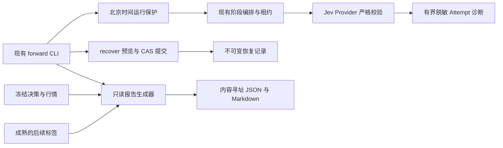

# 前向安全、失败诊断、受控恢复与评估报告设计

## 1. 目标与状态

用户要求一次性完成此前列出的 1–4：前向日期保护、Jev 失败诊断、人工恢复入口、前向评估报告。基线为本地提交 `6e6bcdf`，沿用现有 Python/SQLAlchemy/CLI，不改回测契约、不替沙耶实现回测引擎、不接券商、不自动安装任务。

本文件为完整设计，待用户确认后写实施计划并连续实现四项；现在没有修改产品代码。已有 REQUIREMENTS.md R1–R60 保持冻结，新条目 R61–R64 的内容在本文件提出，不提前写成已完成需求。

## 2. 前置条件与方案选择

现有工作树 `C:/Users/1/Desktop/FKQTPRO/fkqt-jevInvestor-phase5-daily-runner`，解释器 `C:/Users/1/Desktop/FKQTPRO/fkqt-jevInvestor/.venv/Scripts/python.exe`。测试设置本工作树 src 的 PYTHONPATH，使用每次独立的 data/test-runs 目录。

比较三种实现：只加 CLI 提醒不能约束直接调用 Runner；改造为新服务会增加部署与兼容成本；在现有 Runner、Provider、Repository 和 CLI 上加法扩展最小且可审计。选择第三种，复用现有租约、事务、正式键、标签生成器和 Decimal，不新建调度或训练框架。

恢复继续使用 SQLAlchemy 独立事务及条件 UPDATE，不共享并发 AsyncSession；参考 [SQLAlchemy 官方事务说明](https://docs.sqlalchemy.org/en/20/orm/session_basics.html)。概率评估采用标准多类 Brier score，不训练校准器，参考 [scikit-learn 官方多类示例](https://scikit-learn.org/1.8/auto_examples/calibration/plot_calibration_multiclass.html)。不因为指标名称引入新运行依赖。

## 3. 需求锁定提案

| 编号 | 要做 | 不做与约束 |
|---|---|---|
| R61 | 普通 forward run 拒绝北京时间未来日期及当日 15:00 前运行；程序入口和直接 Runner 调用一致 | 检查必须在租约、数据库记录、目录创建、外部请求之前；不得用 force 参数绕过；历史重放仍显式保持历史语义 |
| R62 | 新 Jev Attempt 保存有界脱敏诊断、具体稳定校验原因和响应内容哈希 | 不保存 Key、Header、SDK 自由异常文本或任意模型自由文本；不改变概率容差、问题、标签和有效结果；不补写旧失败原响应 |
| R63 | 提供人工 recover 的只读预览与显式提交，CAS/租约保护、不可变恢复审计 | 不删除旧错误，不改成交/NAV/权益/冻结输入，不重置正式 Jev/LLM 结果，不自动重试永久失败 |
| R64 | 只读生成区间 JSON/Markdown 评估报告，决策完整性、调用质量与成本覆盖、收益回撤、成熟标签及概率评分 | 不把未成熟标签填零，不把未知调用费写成免费，不凭单次成功或空仓判策略有效，不将未来标签送回决策，不混税务/模式/配置样本 |

## 4. 架构与边界

Report、后续标签和恢复审计不得进入 Jev 或 LLM State。修改只落本工作树；FKQT 采集策略、Contributor backtest 路径、旧 ExecutionBundleV1 保持不变。

## 5. 项目 1：前向日期保护

输入：trade_date、带时区的 now、配置起始日。以现有 CHINA_STANDARD_TIME 转换 now，不依赖机器本地时区。

1. now 无时区继续拒绝 FORWARD_TIMEZONE_REQUIRED。
2. trade_date 晚于北京时间当天：返回 BLOCKED/FORWARD_FUTURE_DATE。
3. trade_date 等于当天且北京时间早于 15:00：返回 BLOCKED/FORWARD_BEFORE_MARKET_CLOSE。
4. 起始日之前仍拒绝 FORWARD_BEFORE_START；其余情况才进入原日历/数据就绪流程。
5. 15:00 只代表允许检查，不证明行情已齐；必须继续通过冻结日历、行情完整性和截止时间校验。
6. CLOSED 只有在可运行时段且读取真实日历后才能确认；未来周末不能例外绕过。

拒绝结果不调用 Provider、不创建 NAV、不写 outbox 或租约，仅向调用者报告稳定码。过去日期可用于已有历史重放流程，报告仍不标为真实前向。

验证输入覆盖 UTC 与北京时间跨日、14:59:59、15:00:00、未来日、无时区、历史实验、起始日前及无副作用断言。

## 6. 项目 2：Jev 失败诊断

复用现有响应归一化与正式响应哈希；新诊断不是无边界 SDK dump。保存模型 ID、问题版本、输入/响应哈希、问题集合及每题有限标签概率、选择标签、稳定校验码。

概率字段只接受有限数值的有界字符串；未知问题/标签保存标识哈希与数量，不保留任意自由字符串。异常只映射已知校验常量：问题集合、标签集合、非有限/越界概率、概率总和、所选标签与最大值不一致、结构错误；不保存原 ValidationError 输入或完整异常文本。

新增 Attempt 的可空诊断 JSON 和 usage JSON，旧 Attempt 默认为空。保留既有 error_code，诊断另有 reason_codes，避免破坏既有调用者。Provider 成功与契约失败均携带合法诊断；Provider 传输失败仅记录异常类型白名单及请求身份，不伪造响应。

新 CLI 诊断查询只读指定组合/日期关联的 Attempt，可定位问题 ID 与原因，不重新调用模型。诊断总大小上限 16 KiB，超限只保留元数据、计数和哈希，明确 truncated=true。

usage 只保存实际 SDK 已提供且合法的非负计数，缺失为 null。DeepSeek 侧同样只读实际 usage 并加法保存，不从文本长度猜 token，不改变决策内容。

验证所有失败分类、截断、Secret/未知标签注入、成功结果与旧哈希不变、数据库往返、查询无外部请求。

## 7. 项目 3：受控人工恢复

命令接口：`forward recover --config ABS_PATH --date YYYY-MM-DD --stage STAGE --reason REASON` 默认仅预览；加 `--commit --expected-stage-hash HASH` 才修改。

默认预览返回组合、日期、配置哈希、阶段原状态、失败码、输入/结果哈希、后续阶段与业务提交情况、允许与否及稳定拒绝码。reason 为操作员解释，长度 1–256，禁止控制字符和 Secret 格式；审计不保存命令环境。

只允许当前配置下第一个 FAILED 阶段，且后续没有成功或运行中的阶段。CALENDAR、EXECUTION_PUBLISH、EXECUTION_PREPARE、EXECUTE、CANDIDATE_PREPARE、DECISION_PUBLISH 可在业务一致性检查后恢复；DECIDE、VERIFY 的正式模型失败不能借恢复重新评估，返回 FORWARD_RECOVERY_MODEL_REEVALUATION_FORBIDDEN。

提交时获取组合独占租约，重读全部事实，并以预览阶段哈希进行 CAS。原状态快照与操作者原因、UTC 时间、配置/输入身份保存到新的不可变 ForwardRecoveryRecord。同事务把运行阶段转为 RETRY_PENDING、next_retry_at=当前时刻；累计 attempts 不清零，恢复授权提供一次显式机会，不重新打开无穷自动重试。

恢复不删除任何文件、成交、NAV、权益、正式模型结果。EXECUTE 若已提交业务事实，仍由原执行幂等与包哈希检查恢复，不再次成交；证据不一致直接拒绝。缺文件、变配置或冻结输入冲突不能靠恢复绕过。

重复相同恢复 ID 幂等；过期预览、活跃租约、非 FAILED、未知阶段、已有后续成功或模型重评均拒绝。不得提供清空所有阶段、删除数据库或无条件 force。

## 8. 项目 4：前向评估报告

命令接口：`forward report --config ABS_PATH --from-date YYYY-MM-DD --to-date YYYY-MM-DD --output-root ABS_PATH`。通过既有数据库配置读取同一组合，生成 ForwardEvaluationReportV1 JSON 与中文 Markdown，数据库只读，不发生 Provider 请求。

报告保留 report_version、portfolio_id、区间、生成时间、配置/模型/问题/仓位/税务版本、模式、输入记录身份及 report_hash。不同配置或模型版本分组呈现，不把历史来源重放、真实前向或不同税务版本合成单一收益结论。

### 8.1 完整性与模型运行

列出应有证券数、有效 AVAILABLE 决策数、NO_SIGNAL、DATA_UNAVAILABLE、PROVIDER_UNAVAILABLE、CONTRACT_INVALID、缺记录数及动作 ENTER/KEEP/EXIT/AVOID 分布。状态有效率与动作是否交易分开；合法 AVOID/KEEP 不算失败。分母依据冻结候选与队列外持仓并集，而不是仅查询成功记录。

分别列 Jev UNIVERSE、Jev SYMBOL、LLM 正式结果与 Attempt 调用数、延迟、失败原因及诊断覆盖率；恢复次数单列，不把本地幂等复验算新的 Provider 调用。

### 8.2 调用费用

实际金额只有明确 Provider 用量、货币、计费版本和配置单价都存在时才计算。缺 SDK usage 或历史价格时显示 UNKNOWN、费用覆盖率与调用数量，不记 0，不查询今天价格后回填过去账单。

提供可选独立价格配置：Provider/model/version、有效日期、currency、input/output 每百万 token 单价或明确按请求价格，禁止同时双重计费；只产生估算字段 estimated_cost，不冒充真实账单，原输入和价格配置哈希进入报告。

### 8.3 收益与回撤

按冻结 NAV 顺序计算区间收益和区间最大回撤；初始资金或区间前基准 NAV 明确列出。缺交易日 NAV 标记 DATA_GAP，不能把缺日当收益零。分红收入、卖出已实现收益、费用、成交笔数与换手单列；应收与可用现金分开。

只提供样本区间描述性结果，不凭两股票、一天或零成交输出年化收益、Sharpe 或策略有效性结论。不混模拟成本和 Provider 估算成本，另列扣模型成本的可计算口径及缺失原因。

### 8.4 成熟标签与概率评估

复用 `build_forward_pnl_labels` 和固定版本阈值，从已经冻结的实际后续交易日行情构造标签；禁止自然日填满窗口、禁止 Provider 生成真实标签。标签须校验 symbol、decision_date、预测输入哈希、问题/criteria 版本、来源/日历哈希及最后观察日不晚于报告截至日。

只有成熟且 AVAILABLE 的标签参与评分。对四个盈亏问题分别报告样本数、待成熟数、缺数据数、多类 Brier score、最高概率标签命中率及固定 10 桶 top-label 可靠性统计。Brier 采用未折半多类公式 `mean(sum((p_k - y_k)^2))`，范围 0–2；固定精度 Decimal，概率为零合法。不对 data_sufficiency 或候选池整体问题伪造个股盈亏标签。

报告命中率分母仅成熟可比样本，同时显式显示全体覆盖率，避免选择性只看成功样本。没有成熟标签时评分 null，标为 PENDING_LABELS；不是评分 0。

### 8.5 输出与冲突

JSON 为完整可机读交付，Markdown 为同源人读交付；以 report_hash 内容寻址写入 output-root。相同输入/版本除生成时间外的结果确定一致；既有相同文件复用，冲突拒绝，不覆盖原报告。恢复原因、诊断自由字段不出现在汇总报告。

## 9. 迁移与目录范围

计划加一个新的 0010 迁移：Jev/LLM Attempt 可空诊断/用量字段与 ForwardRecoveryRecord 表。旧记录保持空；新增字段不能破坏正式模型键、结果 Schema、旧 V1 hash 或回测 Entity。

降级如果存在新诊断、用量或恢复记录，明确拒绝数据丢失；只有空 Fixture 可以往返。不要改沙耶要求的契约标签或 Contributor 文件。

| 路径（相对当前工作树） | 用途 |
|---|---|
| src/fkqt_jevinvestor/operations/runner.py | 入口保护与恢复消费 |
| src/fkqt_jevinvestor/operations/cli.py | recover/diagnostics/report 路由 |
| src/fkqt_jevinvestor/operations/recovery.py | 预览和受控提交 |
| src/fkqt_jevinvestor/operations/evaluation.py | 只读汇总与报告 |
| src/fkqt_jevinvestor/providers/jev_market.py | 严格校验诊断 |
| src/fkqt_jevinvestor/providers/deepseek_decision.py | 真实用量归一化 |
| src/fkqt_jevinvestor/persistence/ | 加法审计字段与事务 |
| src/fkqt_jevinvestor/services/forward_labels.py | 复用现有标签生成，不改阈值 |
| src/fkqt_jevinvestor/cli/main.py | 命令参数 |
| migrations/versions/0010_forward_safety_evaluation.py | 新审计迁移 |
| tests/unit/ 与 tests/integration/ | 新增与受影响验证 |
| docs/runbooks/forward-operations.md | 完整可运行命令和排错 |

上述是拟修改范围，不声称所有文件已存在。绝对根为 `C:/Users/1/Desktop/FKQTPRO/fkqt-jevInvestor-phase5-daily-runner`。

## 10. 执行依赖、预期产物与自检

连续执行顺序：日期保护 → 诊断/用量与迁移 → 恢复事务 → 报告/标签评估 → CLI/文档/最终定点验收。报告和恢复依赖迁移，不能先提供假接口；不逐项询问是否继续。

| 检查项 | 标准值 | 检查方法 | 优先级 |
|---|---|---|---|
| 日期保护 | 禁止未来/收盘前，无业务或外部副作用 | 边界时间单元与 Runner 集成测试 | 必须 |
| 诊断安全 | 16 KiB 上限，Secret/自由文本不持久化 | 恶意字段、截断、数据库往返测试 | 必须 |
| 原校验 | 概率和/标签规则不放宽 | 旧 Provider 测试及新失败分类测试 | 必须 |
| 恢复安全 | CAS 原子、保留历史、不重复业务或模型调用 | 并发/过期预览/提交后崩溃/模型拒绝测试 | 必须 |
| 报告只读 | 数据库业务行不变，无网络 | 前后快照与禁止 process 测试 | 必须 |
| 数据完整性 | 成熟标签才评分，缺失显式标记 | 未来窗口/缺 NAV/空样本/版本冲突测试 | 必须 |
| 算法口径 | Decimal 与手算样例逐字段一致 | 收益、回撤、Brier、费用配置样例 | 必须 |
| 兼容迁移 | 原契约不改，新审计非空拒降级 | 空迁移往返与数据丢失守卫 | 必须 |
| 测试节制 | 最小 RED/GREEN，修后仅失败项 | 保留实际命令与首次结果，不重复旧全套 | 必须 |

## 11. 已知限制与排错约束

旧 Jev 失败原响应不可恢复；新诊断只解决之后的可观测性，不编造根因。SDK 未提供用量时不能补算真实费用。尚无成熟未来窗口时只能生成完整 PENDING_LABELS 报告，不宣称概率有效。

recover 不修复根因，不解除冻结输入冲突；模型重评必须独立实验，不能伪装恢复同一正式记录。新恢复机制也不能恢复已删数据库或不存在的历史权益。

写完四项不代表未来交易日已发生、计划任务已启动、回测引擎已合并或策略能盈利。

## 12. 设计自检与交付清单

设计已覆盖四项及全部失败边界，使用已有框架；无券商、常驻服务、动态因子权重、模型自动替换或 Contributor 改动。明确 UNKNOWN/PENDING 与拒绝条件，没有用占位值冒充实现。

当前交付文件只有本设计：`C:/Users/1/Desktop/FKQTPRO/fkqt-jevInvestor-phase5-daily-runner/docs/superpowers/specs/2026-09-26-forward-safety-evaluation-design.md`。既有 REQUIREMENTS.md、task_plan.md、findings.md 继续保存当前状态；待确认后将 R61–R64 写入需求文件并形成实施计划。
