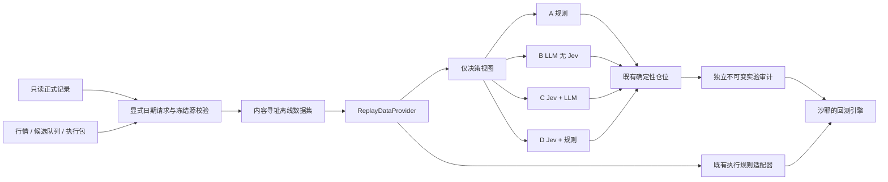

# 研究数据集与四组对照接线设计

## 目的与边界

对应 R65–R69，执行用户“除了沙耶之外的活都先干了”的要求。沿用 R26、R34–R36 已确认架构；本轮不写回测循环，不动 `backtest/` 和 `tests/backtest/`，不启用真实账户。延续用户此前“不在任务间暂停”的执行约定。

## 数据流

## 发布格式

request 包含 database_path、dataset_id、按决策日排序的 days；每项提供 market_snapshot_hash、candidate_queue_path、execution_bundle_path、可选正式 run_id。数据库只通过 SQLite mode=ro/query_only 读取。同一事务取得快照特征与目标；正式持仓取 DECISION_INPUT 快照，不能使用当前账户反推历史。

每个日块包含完整冻结 MarketSnapshot、特征、候选队列和已验证执行包。manifest 包含 dataset_id、版本、有序日期/日块 hash 和完整 ExecutionPolicy，成本参数进入 dataset hash。特征证券必须有对应证券状态与必要日线；缺状态不能绕过公司行为校验。完整验证后才写 manifest；重复完全相同文件可复用，不同内容拒绝覆盖。

ReplayProvider 的 load_day 返回旧 ReplayDay，decision_dates 仅返回区间内的日期；额外提供 warmup_dates(start, count)，不足则拒绝。日期必须按前一快照 next_trade_date 连续，不能用自然日补齐。D+1 包可以包含更广的证券，但所有决策特征证券和跨日潜在持仓必须覆盖。

## 决策和审计

A 基线使用 return_20d > 0 入场、< 0 退出，缺值 NO_SIGNAL，零值不入场/已有仓保持。D 要求有效双层 Jev，SUFFICIENT 概率 >= 0.6；LOSS/HIGH/RISK_OFF >= 0.6 为不入场或退出；PROFITABLE >= 0.6 且 PROFIT >= 0.5 为入场，否则保持/避免。阈值仅为冻结的消融基线，不调参择优。

B/C 共享离散输出 Schema；B payload 无 Jev 字段；C 使用既有 Jev 状态构造和官方 Provider，候选池调用一次。独立输出保存日期、持仓 hash、配置 hash、输入、实际响应哈希与用量。失败无伪概率，不静默替代。审计键包含所有配置和持仓，缓存严格命中才复用。独立实验 ID 避免污染正式 Provider 表。

原记录目标导出保存正式 sizing run、完整决策持仓 hash 与对应 day hash。FrozenRecordedTargetProvider 必须严格核对组合状态，拒绝不同持仓，不把原 C 组目标用作跨组的独立决策。

## 执行与公司行为

执行适配器消费三个旧接口参数，复用 PortfolioLedger/build_order_drafts/execute_order_batch。记录包含 FIFO lot 的适配器内部连续状态，调用者状态和预期后状态 hash 必须匹配，初次接入仅允许现金组合，避免从聚合成本伪造 FIFO。返回逐日 Equity、费用和订单统计，沙耶负责收益汇总。每次 execute 使用临时复制账本，验证成功再提交适配器内部状态。

旧接口不能携带完整公司行为与现金空仓日独立日历。研究适配器绑定数据集获取日期证明，遇到任何公司行为事件/权益或相关未知状态明确报错；前向 V2 权益能力不受影响，不声称旧回测支持权益。

## 可比性

compare_results 检查四组唯一、数据集/起止/预热/初始资金/基准/执行版本/仓位版本完全一致和执行日期一致。CLI 还必须读取独立实验审计旁证，逐日核对完整配置与完整仓位参数；缺记录、同日分支或参数不一致均拒绝。Python 不提供旁证时仅标记 DECLARED_CONFIG_ONLY，不声称实际参数已验证。不改变旧 BacktestResult 契约，不填造结果，不给收益有效性结论。

历史动作按完整 BacktestConfig、策略配置与组合身份隔离，并携带前序审计 hash。同日多持仓分支必须拒绝歧义；已经冻结后续日期后，不得补写更早日期改变输入链。需要分叉或重评时使用独立 run_id。持有交易日以成功执行的冻结交易日计数，包含当前日，与正式账本同口径。

## 验收

验证不可变写入、防前视、缺预热、B 输入隔离、失败保持持仓、执行费用与 T+1、原持仓绑定、导出源库不变、CLI 全入口和四组一致性。测试先最小失败后通过，修复只重测失败；最终一次受影响回归及静态检查。不消耗真实 API 额度。
